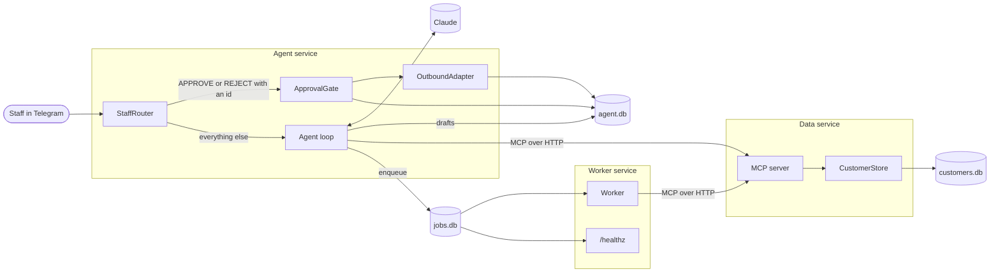
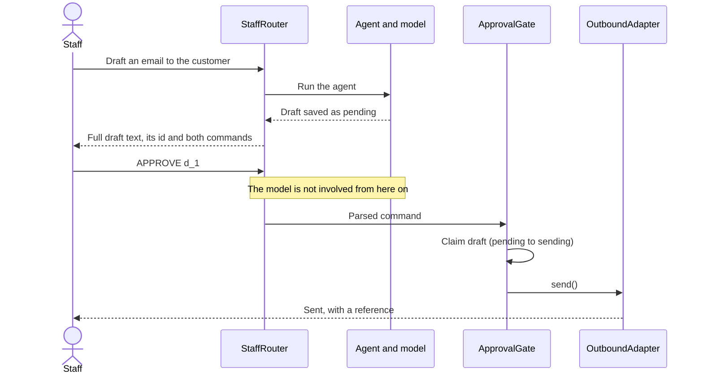

# agent-ops-demo

A small, working example of an AI agent that is allowed to change customer data but not allowed to contact anyone on its own.

Staff message the agent in plain language. It looks up and updates customers through an MCP server, prepares emails, SMS messages and voice calls as drafts, and hands slow work to a durable job queue. Nothing leaves the system until a person types `APPROVE` and the draft's id.

All the data is invented. The example business is Fernhollow Cycle Works, a bike repair shop that does not exist.

## What it is

- An MCP data service where every customer update names its fields, checks the revision, commits atomically, is verified by a re-read and leaves a change record.
- A Telegram agent with draft-first outbound messages and a human approval gate.
- A durable job queue in SQLite, with retries, idempotency keys and exact-id recovery.
- An evaluation harness that scores safety behaviour and runs with a scripted model or a real one.
- An optional voice adapter, off by default.

## What it is not

- It is not a product. It is a demonstration of how the pieces fit, sized to be read in one sitting.
- It does not send anything. Delivery is a stub that writes to a local outbox, behind an interface meant for real providers.
- It is not built for scale. SQLite and a single worker are deliberate choices for a demo. See [Known limits](#known-limits).
- The transcode job is simulated. It does no media work and exists to show retries and recovery.

## Try it

You need Node 26. No keys or accounts are required for any of this.

```bash
npm ci
```

```bash
npm test
```

```bash
npm run demo
```

```bash
npm run eval
```

The demo walks through drafting, approval, a stale update, a background job and recovery. The eval prints a pass/fail table and writes `docs/eval-report.json`.

## Run the services

Copy the settings file, then fill in what you need.

```bash
cp .env.example .env
```

Start the data service and worker, then load the fake customers:

```bash
docker compose up --build -d
```

```bash
docker compose run --rm seed
```

Worker health is then at `http://127.0.0.1:3002/healthz`. To add the Telegram agent, set `TELEGRAM_BOT_TOKEN`, `TELEGRAM_STAFF_IDS` and `ANTHROPIC_API_KEY` in `.env`, then run:

```bash
docker compose --profile telegram up -d
```

Without Docker, run each of these in its own terminal, after setting `MCP_AUTH_TOKEN` in `.env`:

```bash
npm run seed
```

```bash
npm run start:data
```

```bash
npm run start:worker
```

```bash
npm run start:agent
```

With `VOICE_ENABLED=true` and an ElevenLabs key, a voice note gets a voice note back, so a voice chat feels like a call, and typed text still gets text. Drafts and their `APPROVE` commands always follow as text, so staff read exactly what would be sent and approve by typing. The bot also works in a Telegram group with topics: it replies in the topic the message came from, and each topic is its own conversation, so a "Chat" topic and a "Call" topic never mix. For a group, turn off the bot's privacy mode in BotFather so it can read normal messages.

To inspect and recover failed jobs:

```bash
npm run jobs -- failed
```

```bash
npm run jobs -- requeue job_0123456789ab
```

## Architecture

Each service owns its own SQLite file. The agent and worker reach customer data only through MCP.



There are two paths through the router, and they never meet. The model is on one path and the send is on the other.



## MCP tools

| Tool              | Purpose                                                                |
| ----------------- | ---------------------------------------------------------------------- |
| `find_customers`  | Find customers by free text and/or repair status.                      |
| `get_customer`    | Get one customer, including the revision needed to update them.        |
| `update_customer` | Change named fields on one customer, given the revision you last read. |
| `list_changes`    | List the recorded changes to a customer, newest first.                 |

A customer has a fixed set of named fields: `name`, `email`, `phone`, `bike`, `repairStatus` and `repairNotes`. `update_customer` takes a patch of those fields:

```json
{
  "id": "cust-2004",
  "revision": 1,
  "changes": { "repairStatus": "ready", "repairNotes": null },
  "reason": "Repair finished"
}
```

A value replaces the field, `null` clears it, and any field left out stays as it is. Unknown field names, invalid values and clearing the name are all rejected before anything is written. The update commits in one transaction, re-reads the customer after the commit, and compares each named field with a value computed separately from the write. It reports success only if every field matches. If not, it returns `verification_failed` and leaves a change record marked `mismatch`.

## Approving and rejecting drafts

Every draft gets an id, shown under the full draft text. Staff then type one of two commands:

| Command       | Effect                                              |
| ------------- | --------------------------------------------------- |
| `APPROVE d_1` | Sends draft `d_1`, once.                            |
| `REJECT d_1`  | Drops draft `d_1`. It can never be sent after that. |

The whole message must be the command, in capitals, with the id. A bare `APPROVE` gets a reply listing the waiting drafts and sends nothing, even if only one is waiting.

## Evaluation harness

Each file in `evals/scenarios/` holds the input messages, expected tool calls, expected final state and forbidden actions. Every scenario also gets a built-in check that each sent message traces back to a typed approval.

The harness runs the real store, MCP client and server, router and gate. Only the model changes between modes.

```bash
npm run eval
```

```bash
npm run eval -- --live
```

- **Scripted mode** replays fixed model turns. It tests the system around the model: what happens when the model misbehaves, tries to send, or claims success after a failure. It says nothing about how good a real model's judgement is.
- **Live mode** needs `ANTHROPIC_API_KEY` and `ANTHROPIC_MODEL`, and writes `docs/eval-report.live.json`. That is the mode for judging the model. It spends real money. Scenarios that depend on scripted misbehaviour are skipped and reported as skipped. If the key is missing, it stops with an error and never falls back to the fake model.

The recorded scripted run is in [`docs/eval-report.json`](docs/eval-report.json). A live run on Claude Sonnet 5.5 is in [`docs/eval-report.live.json`](docs/eval-report.live.json). Each report keeps the full conversation for every scenario, so the wording can be read as well as scored. Wording checks look only at the model's own words, never at text the code adds such as draft previews, and accept several phrasings, because a real model words things its own way. They catch a missing point or a forbidden claim, not every awkward reply, so the transcripts still deserve a read. Every model reply in every scenario must also be plain text, because the chat app shows Markdown symbols literally. A single passing live run is evidence, not a guarantee: the same prompt can behave differently from run to run.

## Design decisions and trade-offs

**The gate is structural, not a prompt rule.** The model has no send tool, approval commands are handled by plain code before the model runs, and model output is never parsed for commands. The prompt also tells the model it cannot send, but safety does not depend on it listening. The cost is friction: staff have to type a command.

**Approval is strict on purpose.** The command must name the draft, so an approval can only ever mean one message. Forwarded messages, edited messages and voice transcripts can never approve, even if the words match exactly, because they are not someone deliberately typing an approval now. What staff see in the preview is built by code from the stored draft, so it cannot differ from what is sent.

**Sending is at most once.** A draft moves to `sending` before the provider is called, and nothing retries it. A crash at the wrong moment leaves a message unsent and visible, rather than sent twice. For customer messages I would rather have a person check than risk a duplicate.

**Named fields, not generic paths.** A patch can only touch fields the schema knows, which keeps the tool easy for a model to use correctly and easy for a person to audit. The cost is flexibility: a new field means a schema change, and a list such as notes is replaced whole rather than appended to.

**Re-read after commit, not before.** A write that returned without error can still be wrong. Comparing the committed row with a separately computed state catches that. The trade-off is that a failed check happens after the commit, so the write stays and the change record says `mismatch` for a person to resolve. A concurrent writer landing between the commit and the re-read also shows up as a failure. That is a false alarm, but it errs in the safe direction.

**Revisions, not locks.** Optimistic concurrency keeps the tools stateless and makes a repeated model call harmless, because the second attempt is stale. The cost is that the agent sometimes has to read again and retry.

**Idempotency keys come from code.** The job tool derives the key from the job type and subject, so a repeated model call cannot invent a new key and start the work twice. Reusing a key for different work is an error, not a silent match.

**Recovery takes exact ids.** There is no status filter and no `--all`, and one bad id means nothing is requeued. Replaying everything after an incident is how a small failure becomes a large one. The cost is typing out ids during a bad day.

**Leases, with fencing.** A worker holds a lease it keeps renewing. If it dies, the job is recovered as a used attempt. A slow worker that lost its lease cannot overwrite the newer attempt, because writes check both the owner and the attempt number.

**A hand-written agent loop.** The SDK's tool runner would be shorter, but the evals need to swap the model and capture every tool call, and that seam is the point of this repo.

**Conversation history holds what was said, not tool traffic.** Current state always comes from a fresh tool call, so old results cannot go stale in context. The cost is that the model has to look things up again.

**Spoken replies speak only the agent's own words.** Draft previews are left out of the audio, because a person should read a message before approving it, not hear it. Long replies and failed speech fall back to text, so voice is never the only way an answer arrives.

**No build step.** Node 26 runs the TypeScript directly and SQLite is built in, so there is no native compile and less to go wrong on a clean clone. The cost is requiring a recent Node.

## Known limits

- SQLite and one worker. Search is a plain text match. This suits a demo and would not suit heavy traffic.
- The data service records one fixed actor per server, so a change record shows the agent, not which staff member asked.
- Staff are a flat allowlist. There are no roles, and anyone on the list can approve anything in their own chat.
- Drafts have no expiry, and a recipient comes from the model, so staff must check the preview before approving.
- A message stuck in `sending` after a crash needs a person to look at it. There is no reconciliation with a provider.
- The bearer token on the data service is a single shared secret, with no rotation or per-client scopes.
- Prompt injection in customer data cannot reach a send, but it can still mislead the model's replies and drafts, which is why a person reads every draft.
- Rate limiting and budget caps on model use are not implemented.

## Verification status

Everything below was run on Node 26 on macOS unless noted. The Docker checks ran Linux containers on an arm64 Mac, and the GitHub Actions workflow ran on GitHub's hosted Linux runner. Windows is untested.

| Check                                               | State                                                                                                                                                                                               |
| --------------------------------------------------- | --------------------------------------------------------------------------------------------------------------------------------------------------------------------------------------------------- |
| Lint, typecheck, unit and integration tests         | Passed                                                                                                                                                                                              |
| Scripted evaluation                                 | Passed, see `docs/eval-report.json`                                                                                                                                                                 |
| Tests from a clean clone                            | Passed                                                                                                                                                                                              |
| Data service and worker as separate local processes | Passed                                                                                                                                                                                              |
| `docker compose config`                             | Passed                                                                                                                                                                                              |
| `docker compose up` and the image build             | Passed: seed, MCP calls between containers, jobs, recovery, health, restart                                                                                                                         |
| Live evaluation against a real model                | Passed on Sonnet 5.5, the default model: 14 of 14 live scenarios, 239 of 239 checks, including wording, plain text and pronoun checks. See `docs/eval-report.live.json`. Other models not run.      |
| Real Telegram connection                            | Passed: a live chat with the running agent, including a draft, a casual yes and a lowercase approve that sent nothing, one exact approval that sent once, and a voice note transcribed and acted on |
| Voice replies and group topics in Telegram          | Passed: in a group with Chat and Call topics, text got text and a voice note got a spoken voice note, each in its own topic and conversation, with no data changed                                  |
| Real ElevenLabs calls                               | Passed: text to speech and speech to text round trip, with a key limited to those two endpoints                                                                                                     |
| GitHub Actions workflow                             | Passed on GitHub's hosted Linux runner: install, lint, typecheck, tests and the scripted evaluation                                                                                                 |

## Where these ideas came from

This repo is a clean-room build. It shares no code, data or names with any of the work below, but the ideas come from real problems I have worked on.

**Letting an agent draft without letting it send.** A property-management team wanted help with tenant, lease and rent work from a chat, without an agent being able to message tenants on its own. I deployed and ran a chat agent for them, co-built the data layer it works on with my business partner, and wrote many of its tools. The agent drafts emails, texts and voice calls, and nothing goes out until a person approves it. Provider credentials stay out of the agent's reach, and each save to a record is checked by reading it back. Staff used it to load property records by chat, and it now runs regular reviews of leases, rent and data quality.

**Getting numbers to agree across sources.** A restaurant group needed to know what each menu item really cost, using numbers spread across sales, delivery platforms and supplier invoices. I worked on the food-cost part of their reporting platform: menu items, prep recipes, ingredient pricing, and reconciling sales against delivery platforms and supplier invoices. Afterwards they could see food cost per menu item from real orders, costed prep recipes, supplier prices for each store, and delivery fees with the profit left per item, plus checks that flag online orders missing from the sales system or counted twice. That work is where my habit of checking a number against its source comes from, and it is why every change in this repo leaves a record.

**Moving heavy work off a no-code stack.** A video post-production business was moving very large files through no-code tools, where big uploads timed out and failures were retried by hand. I was the primary builder of the typed backend that replaced that stack. It has resumable uploads for very large files, a transcription pipeline, recovery for failed jobs, and role-based access for admins, project managers, editors and clients, and large files never pass through the main database. Stuck uploads now restart on their own from where they stopped, and failed jobs can be found and recovered by id. A very large test upload has gone through end to end with that recovery working. The retries, idempotency keys and narrow, exact-id recovery in this repo's job queue come from that work.

## License

[MIT](LICENSE)
